# Manuale Utente - MyLab

## Indice

1. [Introduzione](#introduzione)
2. [Accesso al Sistema](#accesso-al-sistema)
3. [Ruoli Utente](#ruoli-utente)
4. [Area Amministratore](#area-amministratore)
5. [Area Utente](#area-utente)
6. [Funzionalità Dettagliate](#funzionalità-dettagliate)

---

## Introduzione

**MyLab** è una piattaforma web per la gestione di questionari, documenti e risorse condivise categorizzate e raggruppate per progetti aziendali. Il sistema permette di:

- Organizzare progetti per aziende
- Creare e gestire questionari personalizzati con diversi tipi di domande
- Condividere documenti e link tra utenti
- Raccogliere e analizzare risposte ai questionari
- Gestire caricamenti di file da parte degli utenti
- Organizzare contenuti tramite categorie

---

## Accesso al Sistema

### Login

1. Accedi all'URL della piattaforma
2. Inserisci il tuo **indirizzo email** e **password**
3. Clicca su **Accedi**

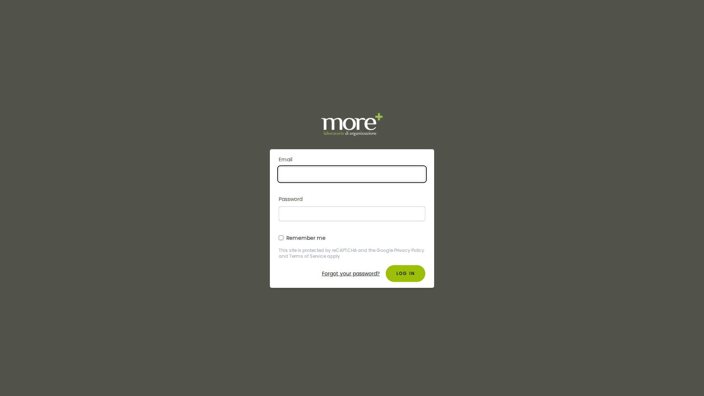

### Recupero Password

Se hai dimenticato la password:

1. Clicca su **"Password dimenticata?"** nella pagina di login
2. Inserisci il tuo indirizzo email
3. Riceverai un'email con le istruzioni per reimpostare la password
4. Clicca sul link nell'email e imposta una nuova password

---

## Ruoli Utente

Il sistema prevede due ruoli principali:

### 👑 Amministratore

Gli amministratori hanno accesso completo al sistema e possono:

- Gestire tutti gli utenti
- Creare e configurare questionari
- Gestire aziende, progetti, categorie
- Visualizzare e esportare tutte le risposte ai questionari
- Amministrare documenti e link
- Visualizzare i caricamenti degli utenti

### 👤 Utente Standard

Gli utenti standard possono:

- Visualizzare e completare questionari assegnati
- Accedere a documenti e link condivisi
- Caricare file personali
- Gestire il proprio profilo

---

## Area Amministratore

Gli amministratori hanno accesso a tutte le funzionalità di gestione tramite il menu principale. Dopo il login, gli amministratori vedono una pagina dashboard e possono accedere a tutte le sezioni di amministrazione tramite il menu laterale.

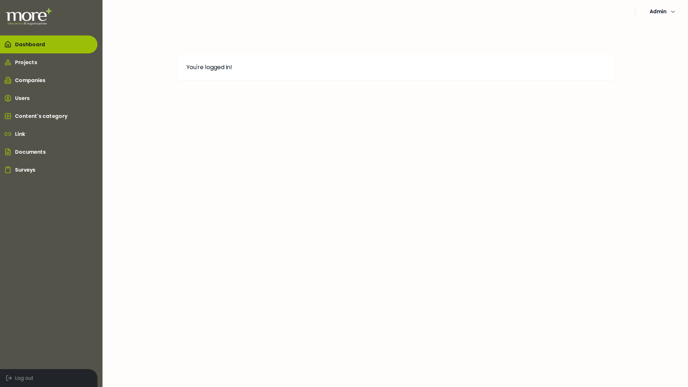

### 🏢 Gestione Aziende

#### Creare una Nuova Azienda

1. Vai su **"Aziende"** nel menu amministratore
2. Clicca su **"Crea nuova azienda"**
3. Inserisci il nome dell'azienda
4. Clicca su **"Salva"**

#### Modificare un'Azienda

1. Nell'elenco delle aziende, clicca su **"Modifica"**
2. Aggiorna le informazioni
3. Clicca su **"Salva"**

#### Eliminare un'Azienda

1. Clicca su **"Elimina"** accanto all'azienda
2. Conferma l'eliminazione

**Attenzione**: L'eliminazione di un'azienda non elimina i progetti e gli utenti associati.

### 📊 Gestione Progetti

#### Creare un Nuovo Progetto

1. Vai su **"Progetti"** nel menu amministratore
2. Clicca su **"Crea nuovo progetto"**
3. Compila i campi:
    - **Nome**: nome del progetto
    - **Descrizione**: descrizione dettagliata
    - **Azienda**: seleziona l'azienda di appartenenza
    - **Trigger di chiusura questionari** (Modalità di come verranno chiusi i questionari): scegli tra "Manual" (manuale) o "Auto" (automatico)
4. Carica un'immagine rappresentativa (opzionale)
5. Clicca su **"Salva"**

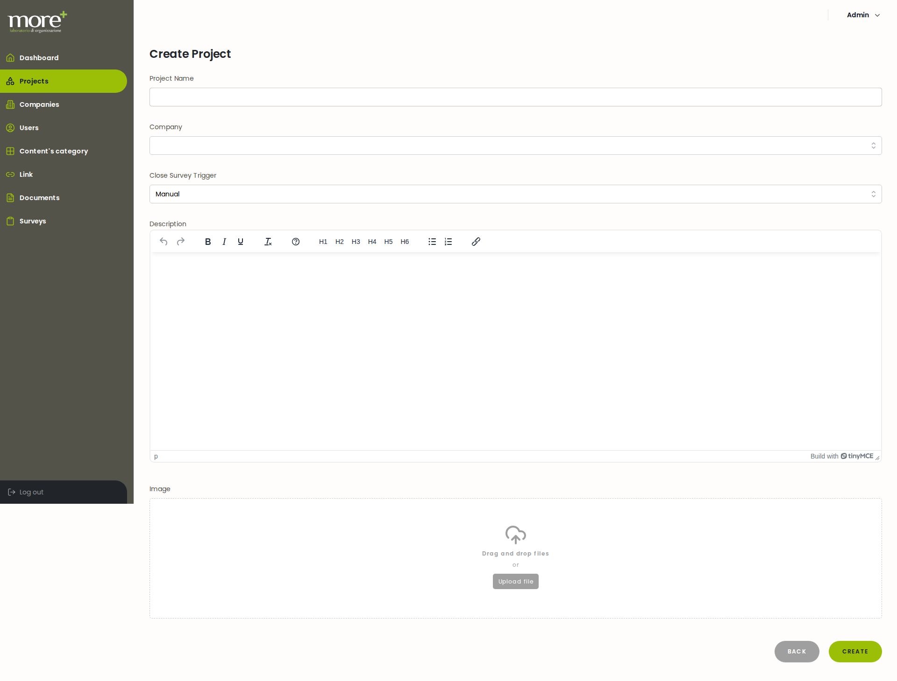

#### Modificare un Progetto

1. Nell'elenco dei progetti, clicca su **"Modifica"**
2. Aggiorna le informazioni
3. Clicca su **"Salva"**

### 👥 Gestione Utenti

#### Creare un Nuovo Utente

1. Vai su **"Utenti"** nel menu amministratore
2. Clicca su **"Crea nuovo utente"**
3. Compila i campi:
    - Nome e cognome
    - Email
    - Password
    - **Ruolo**: Admin o User
    - **Azienda**: associa l'utente a un'azienda
    - **Progetto primario**: progetto predefinito dell'utente
4. Assegna l'utente a **progetti**, **documenti**, **link** e **questionari**
5. Clicca su **"Salva"**

#### Visualizzare i Caricamenti di un Utente

1. Nell'elenco utenti, clicca su **"Caricamenti"** accanto all'utente
2. Visualizzerai tutti i file caricati da quell'utente

#### Eliminare i Caricamenti

1. Nella sezione caricamenti dell'utente, clicca su **"Elimina"** accanto al file
2. Conferma l'eliminazione

### 📋 Gestione Questionari

#### Creare un Nuovo Questionario

1. Vai su **"Questionari"** nel menu amministratore
2. Clicca su **"Crea nuovo questionario"**
3. Compila i campi:
    - **Nome**: titolo del questionario
    - **Descrizione**: spiegazione dello scopo del questionario
    - **Ordine**: per ordinare i questionari nell'elenco
    - **Trigger di chiusura** (Modalità di come verranno chiusi i questionari): (opzionale) scegli tra "Manual" o "Auto". Se non impostato, il questionario eredita il criterio dal progetto
    - **Chiuso**: seleziona la casella per chiudere manualmente il questionario
4. Associa il questionario a:
    - **Categorie**
    - **Progetti**
    - **Utenti**
5. Clicca su **"Salva"**

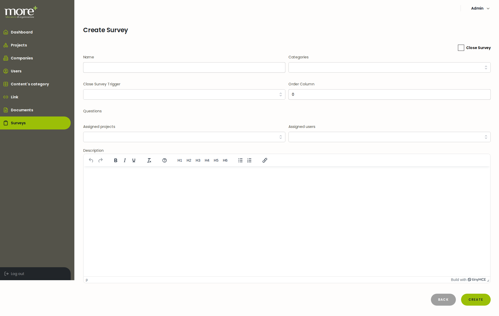

#### Aggiungere Domande al Questionario

1. Apri il questionario in modifica
2. Nella sezione **"Domande"**, clicca su **"Aggiungi domanda"**
3. Compila:
    - **Testo della domanda**: label e description
    - **Tipo di domanda**:
        - [**Testuale**](#creare-una-domanda-testuale): risposta a testo libero
        - [**Opzioni**](#creare-una-domanda-con-opzioni): scelta singola
        - [**Multipla**](#creare-una-domanda-a-scelta-multipla): scelta multipla
        - [**Voto**](#creare-una-domanda-di-tipo-voto): risposta numerica
        - [**Domanda con ordinamento**](#creare-una-domanda-con-ordinamento): Utilizzare domanda di testo
        - **Titolo**: sezione di testo (non richiede risposta)
    - **Obbligatoria**: se la risposta è obbligatoria
4. Se hai scelto tipo **"Opzioni"** o **"Multipla"**, aggiungi le opzioni di risposta:
    - Clicca su **"Aggiungi opzione"**
    - Inserisci il testo dell'opzione
    - Ripeti per tutte le opzioni necessarie
5. Clicca su **"Salva"**
    - **Ordine**: sia le domande che le opzioni sono trascinabili per definire l'ordine, dopo aver salvato, sia le domande che le opzioni delle domande.

### Creare una domanda testuale

Selezionando il tipo **Testuale**, non è richiesta alcuna configurazione aggiuntiva.  
È sufficiente indicare se la domanda è **obbligatoria** oppure **facoltativa**.

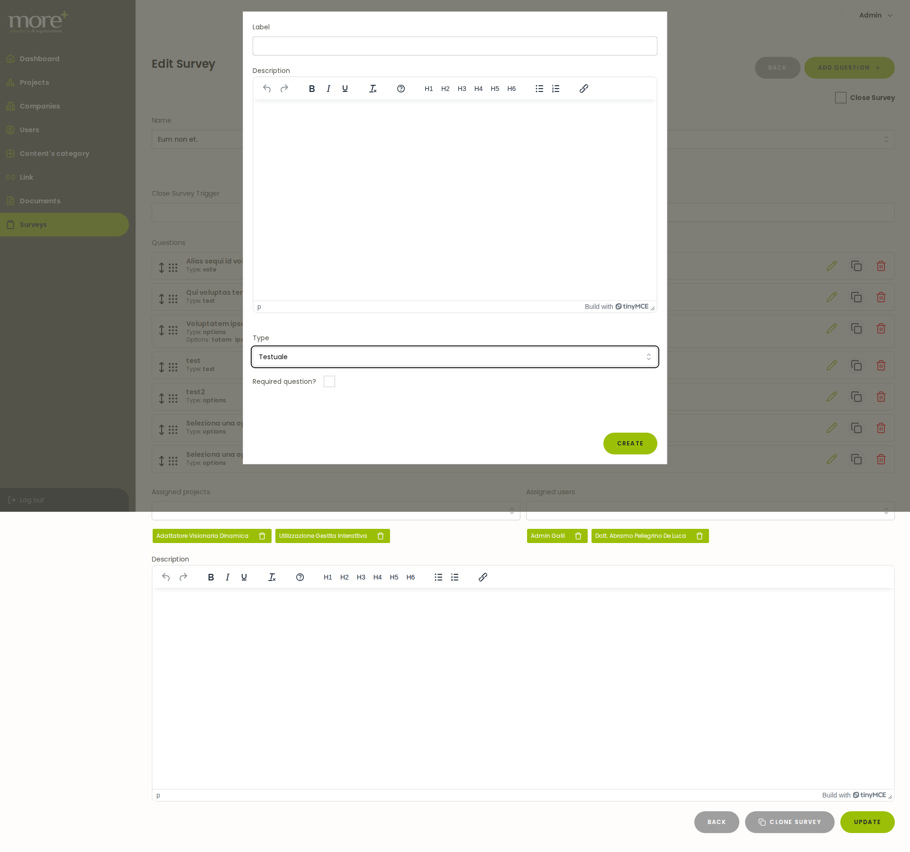

### Creare una domanda con opzioni

Selezionando il tipo **Opzioni**, è necessario seguire questi passaggi:

1. Inserire il testo della domanda e **salvare**.
2. Riaprire la domanda cliccando sull’icona della **matita** (modifica).
3. Aggiungere le opzioni compilando il testo dell’opzione e premendo il pulsante **“+”** per inserirla.
4. Salvare
5. Le opzioni possono essere modificate salvando cliccando il bottone in basso a sinistra "Save", oppure eliminate singolarmente cliccando sull’icona del cestino.
6. Le nuove opzioni diventano ordinabili con il drag & drop dopo averle salvate cliccando su "Save"

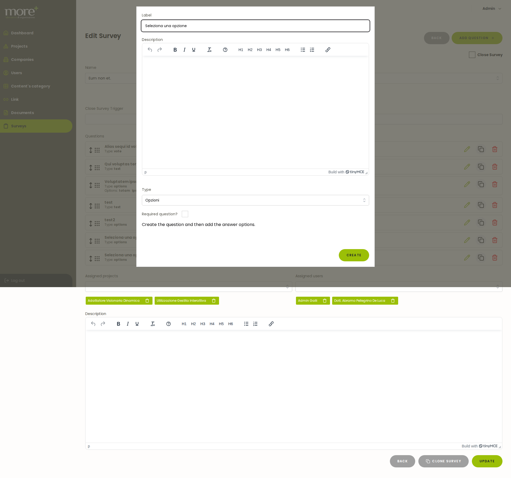

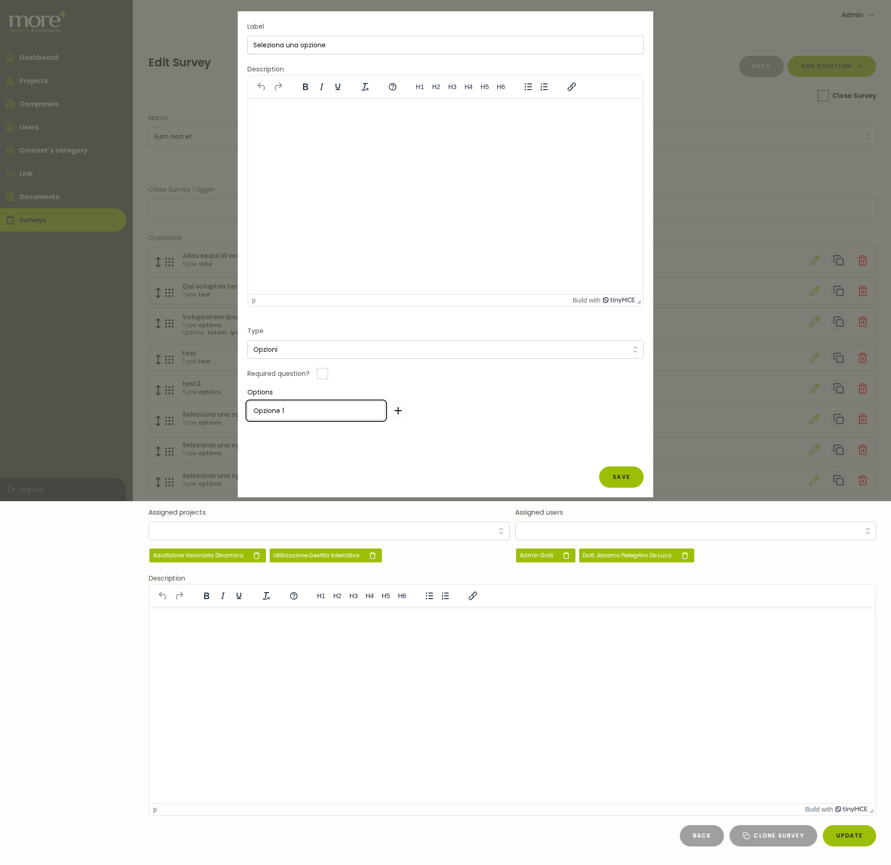

### Creare una domanda a scelta multipla

La procedura è identica a quella delle **domande con opzioni**.  
La differenza è che l’utente potrà selezionare **più risposte** all’interno della stessa domanda.

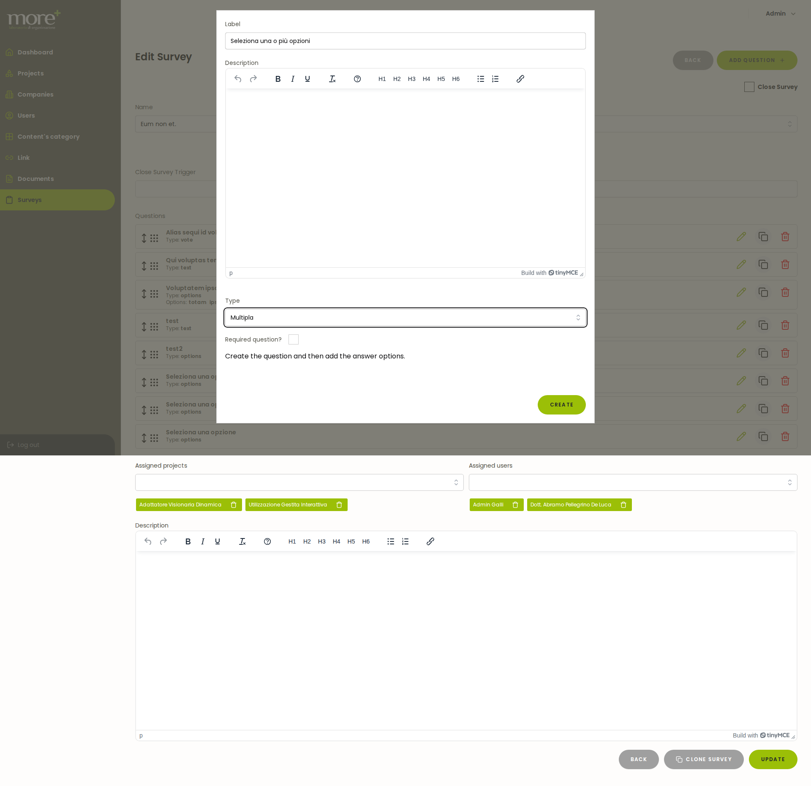

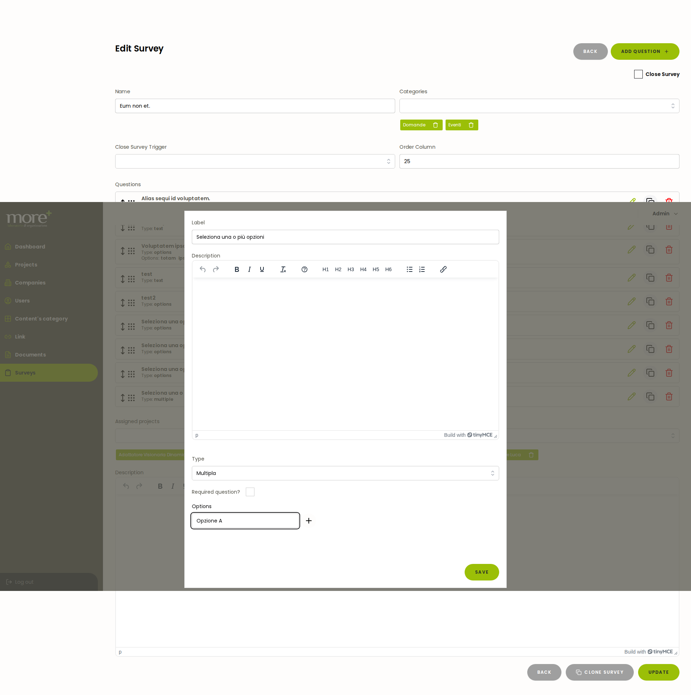

### Creare una domanda di tipo voto

Anche in questo caso la procedura è la stessa delle **domande con opzioni**.  
La differenza è che, al posto del testo, è possibile inserire **valori numerici** per rappresentare il voto.

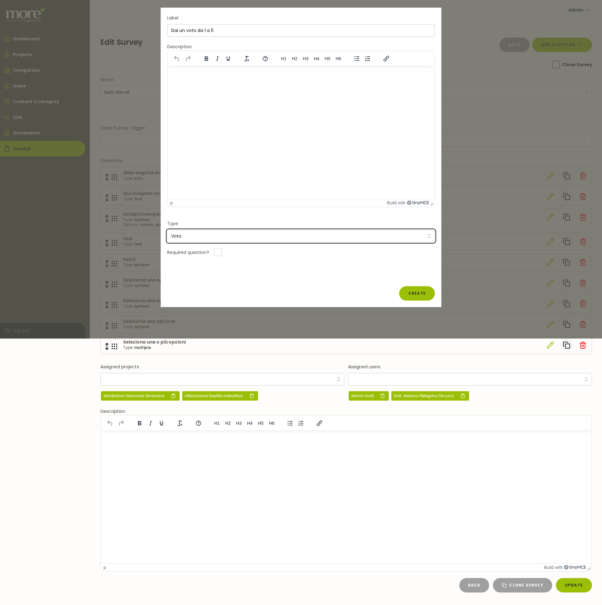

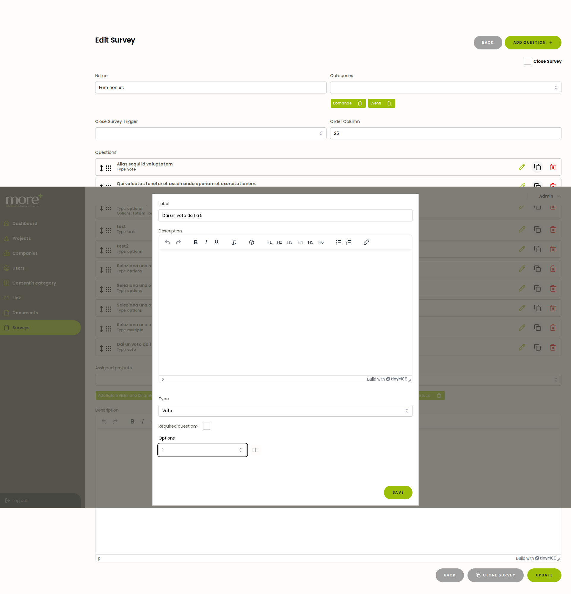

### Creare una domanda con ordinamento

Per richiedere all’utente di ordinare alcune opzioni, è possibile utilizzare una domanda a risposta testuale impostata, ad esempio, nel seguente modo:

**Esempio di domanda:**  
_Ordina le seguenti risposte in base alla tua preferenza:_

1. Lorem
2. Ipsum
3. Dolore

L’utente dovrà quindi inserire la risposta nel campo testuale indicando l’ordine desiderato, ad esempio:

**Esempio di risposta:**  
Dolore, Ipsum, Lorem

---

#### Riordinare le Domande

1. Nella lista delle domande, usa il drag-and-drop per riordinare
2. Oppure modifica il campo **"Ordine"** di ogni domanda

#### Clonare un Questionario

1. Nell'elenco questionari, clicca su **"Clona"**
2. Il sistema creerà una copia completa del questionario con tutte le domande
3. Modifica il nuovo questionario secondo necessità

#### Chiudere un Questionario

Un questionario può essere chiuso in due modi:

1. **Chiusura Manuale**: Modifica il questionario e seleziona la casella "Chiuso". Il sistema registrerà automaticamente la data e ora di chiusura.

2. **Trigger di Chiusura** (Modalità di come verranno chiusi i questionari): Puoi impostare modalità di chiusura del questionario:

    - **Manual** (Manuale): Il questionario rimane aperto per tutti gli utenti assegnati finché l'amministratore non lo chiude manualmente selezionando la casella "Chiuso". Gli utenti possono modificare le loro risposte fino alla chiusura.
    - **Auto** (Automatico): Il questionario si chiude automaticamente per ogni singolo utente dopo che ha inviato le sue risposte. Una volta inviato, l'utente non può più modificare le proprie risposte, ma il questionario rimane aperto per gli altri utenti che non hanno ancora risposto.

**Nota importante sul modalità di Chiusura**:

- Se un questionario non ha una modalità di chiusura specifica, eredita la modalita impostata nel progetto a cui è associato
- Se nessuna modalità è impostato né sul questionario né sul progetto, viene utilizzato il comportamento "Manual" come predefinito

**Differenza tra le due modalità di chiusura**:

- Con **Manual**: tutti gli utenti possono modificare le risposte fino a quando l'amministratore chiude manualmente il questionario
- Con **Auto**: ogni utente può rispondere una sola volta; dopo l'invio, le sue risposte sono bloccate automaticamente (anche se altri utenti possono ancora compilare il questionario)

**Quando il questionario viene chiuso manualmente** (selezionando "Chiuso"):

- Non può più ricevere nuove risposte da nessun utente
- Le risposte esistenti diventano di sola lettura per tutti gli utenti
- Rimane visibile agli utenti che lo hanno completato per consultazione

#### Visualizzare le Risposte

1. Nell'elenco questionari, clicca su **"Visualizza risposte"**
2. Vedrai l'elenco degli utenti che hanno risposto
3. Per ogni utente puoi:
    - Visualizzare le risposte
    - Modificare le risposte (se necessario)
    - Vedere data e ora di compilazione

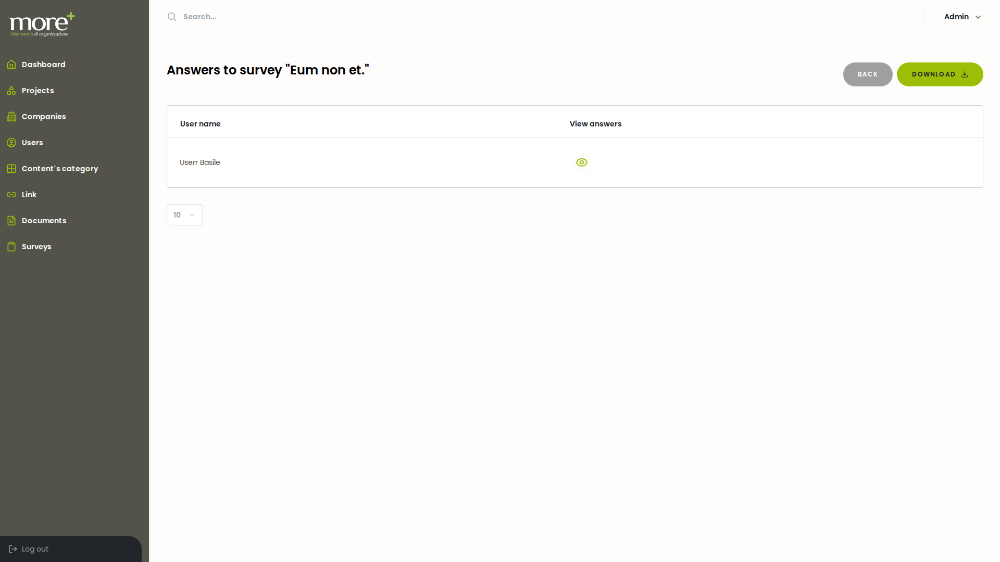

#### Esportare le Risposte

1. Apri il questionario
2. Clicca su **"Esporta risposte"**
3. Il sistema genererà un file Excel con tutte le risposte
4. Il file include:
    - Dati degli utenti
    - Tutte le domande
    - Tutte le risposte
    - Timestamp di compilazione

### 🏷️ Gestione Categorie

#### Creare una Categoria

1. Vai su **"Categorie"** nel menu amministratore
2. Clicca su **"Crea nuova categoria"**
3. Inserisci il nome della categoria
4. Clicca su **"Salva"**

Le categorie servono per organizzare:

- Link
- Documenti
- Questionari

### 🔗 Gestione Link

#### Creare un Nuovo Link

1. Vai su **"Link"** nel menu amministratore
2. Clicca su **"Crea nuovo link"**
3. Compila i campi:
    - **Nome**: titolo del link
    - **URL**: indirizzo web
    - **Credenziali**: eventuali username/password (opzionale)
    - **Ordine**: per ordinare i link
4. Associa il link a:
    - **Categorie**
    - **Progetti**
    - **Utenti**
5. Clicca su **"Salva"**

### 📄 Gestione Documenti

#### Caricare un Nuovo Documento

1. Vai su **"Documenti"** nel menu amministratore
2. Clicca su **"Crea nuovo documento"**
3. Compila:
    - **Nome**: titolo del documento
    - **File**: carica il file dal tuo dispositivo
    - **Ordine**: per ordinare i documenti
4. Associa il documento a:
    - **Categorie**
    - **Progetti**
    - **Utenti**
5. Clicca su **"Salva"**

**Formati supportati**: PDF, Word, Excel, PowerPoint, immagini, ecc.

---

## Area Utente

### Schermata di Benvenuto

Dopo il login, gli utenti standard accedono alla **schermata di benvenuto** che mostra:

- Nome utente e indirizzo email
- Progetto primario assegnato (se presente) con immagine e descrizione
- Accesso rapido alle funzionalità principali tramite menu

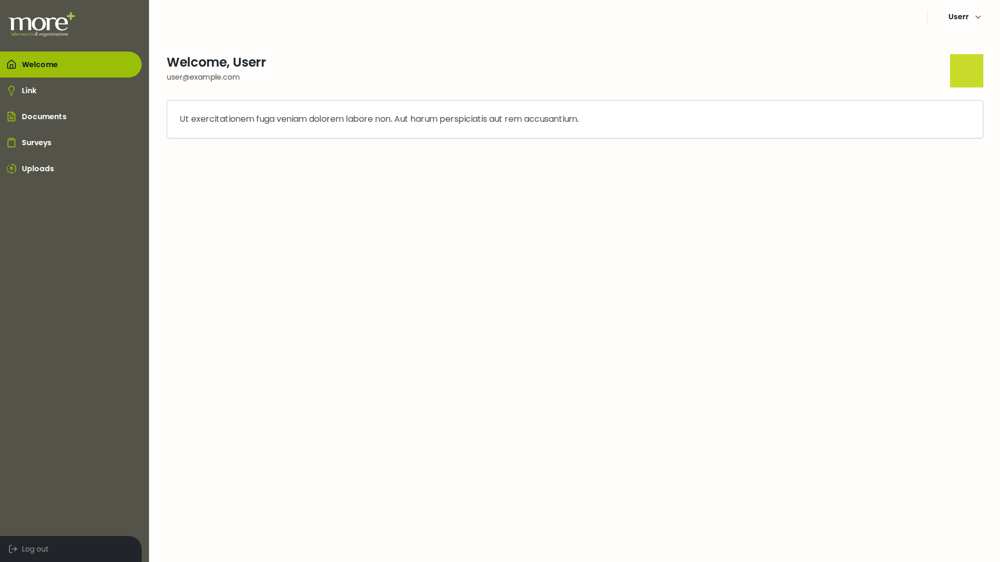

### 📝 Questionari

#### Visualizzare i Questionari Disponibili

1. Dal menu principale, seleziona **"Questionari"**
2. Visualizzerai l'elenco dei questionari a te assegnati
3. Ogni questionario mostra:
    - Nome del questionario
    - Descrizione
    - Stato (da completare/completato)
    - Data di chiusura (se prevista)

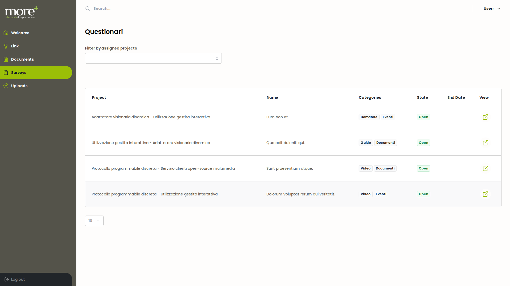

#### Compilare un Questionario

1. Clicca sul questionario che desideri compilare
2. Leggi attentamente le domande
3. Rispondi a tutte le domande obbligatorie

**Tipi di domande disponibili:**

- **Testuale**: risposta a testo libero
- **Opzioni**: scelta singola da un elenco di opzioni
- **Multipla**: scelta multipla da un elenco di opzioni
- **Voto**: assegna un voto numerico
- **Titolo**: sezione informativa (non richiede risposta)

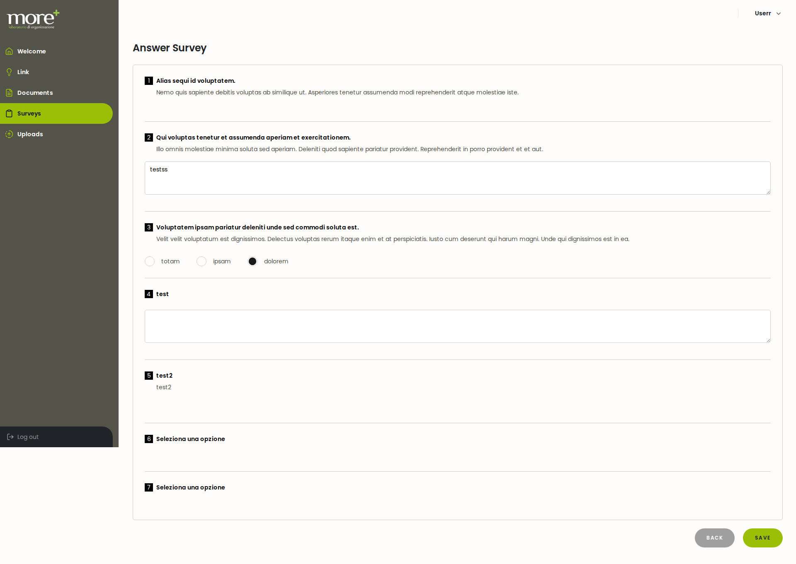

4. Clicca su **"Salva"** per salvare le risposte
5. Se necessario, puoi tornare in seguito per modificare le tue risposte (se il questionario non è ancora chiuso)

#### Modificare le Risposte

1. Vai all'elenco dei questionari
2. Clicca su **"Modifica"** accanto al questionario completato
3. Apporta le modifiche necessarie
4. Clicca su **"Salva"** per confermare

**Nota**: Non è possibile modificare le risposte dopo che il questionario è stato chiuso dall'amministratore.

### 🔗 Attività e Link

#### Accedere ai Link Condivisi

1. Dal menu principale, seleziona **"Attività"**
2. Visualizzerai l'elenco dei link assegnati al tuo profilo o ai tuoi progetti
3. I link sono organizzati per:
    - Categorie
    - Progetti

#### Utilizzare i Link

- Clicca sul pulsante **"Link"** (icona freccia esterna) per aprire il link in una nuova scheda
- Se il link ha credenziali associate, clicca su **"Show credentials"** per visualizzarle

### 📄 Documenti

#### Visualizzare i Documenti

1. Dal menu principale, seleziona **"Documenti"**
2. Visualizzerai tutti i documenti a te assegnati
3. I documenti sono organizzati per:
    - Categorie
    - Progetti

#### Scaricare un Documento

1. Trova il documento nell'elenco
2. Clicca sull'icona di **download**
3. Il file verrà scaricato sul tuo dispositivo

#### Visualizzare un Documento

- Clicca sul pulsante **"View"** (icona occhio) per visualizzare il documento direttamente nel browser (se il formato lo permette)

### 📤 Caricamenti

#### Caricare un File

1. Dal menu principale, seleziona **"Caricamenti"**
2. Clicca su **"Carica nuovo file"**
3. Seleziona il progetto di riferimento
4. Clicca su **"Scegli file"** e seleziona il file dal tuo dispositivo
5. Aggiungi una descrizione (opzionale)
6. Clicca su **"Carica"**

**Nota**: I file caricati saranno visibili agli amministratori e all'utente che li ha caricati.

#### Visualizzare i Tuoi Caricamenti

1. Nella sezione **"Caricamenti"** puoi vedere tutti i file che hai caricato
2. Per ogni file sono visualizzati:
    - Nome del file
    - Progetto associato
    - Data di caricamento

#### Eliminare un Caricamento

1. Trova il file nell'elenco dei tuoi caricamenti
2. Clicca su **"Elimina"**
3. Conferma l'eliminazione

### 👤 Profilo Personale

#### Modificare il Profilo

1. Clicca sul tuo nome utente in alto a destra
2. Seleziona **"Profilo"**
3. Modifica le informazioni:
    - Nome
    - Email
    - Password
4. Clicca su **"Salva modifiche"**

#### Cambiare la Password

1. Vai al tuo profilo
2. Nella sezione **"Aggiorna password"**
3. Inserisci:
    - Password attuale
    - Nuova password
    - Conferma nuova password
4. Clicca su **"Salva"**

---

## Funzionalità Dettagliate

### Sistema di Permessi

Il sistema utilizza permessi granulari per controllare l'accesso:

- Gli utenti vedono solo questionari, documenti e link a loro assegnati
- Ogni utente può visualizzare e modificare le proprie risposte ai questionari (se il questionario non è chiuso)
- Gli amministratori possono visualizzare tutte le risposte di tutti gli utenti
- I caricamenti sono visibili solo all'utente che li ha caricati e agli amministratori

### Associazioni Multiple

Ogni elemento (questionari, documenti, link) può essere associato a:

- **Categorie**: per organizzazione tematica (solo scopo di filtro visivo, non determina accesso)
- **Progetti**: per associazione a progetti specifici
- **Utenti**: per assegnazione diretta

Un utente visualizza un elemento se:

- È direttamente assegnato all'utente, OPPURE
- È assegnato a un progetto dell'utente

**Nota**: Le categorie servono solo per organizzare visivamente gli elementi (filtro nella UI), non determinano l'accesso. Un utente non può accedere a un elemento solo perché è associato a una categoria, deve essere assegnato direttamente all'utente o al suo progetto.

### Caricamento File

Gli utenti possono caricare file associati ai loro progetti:

- I file sono archiviati in modo sicuro
- Gli amministratori possono monitorare tutti i caricamenti
- I file possono essere eliminati dagli amministratori o dall'utente che li ha caricati
- Solo l'utente che ha caricato il file e gli amministratori possono accedervi

---

_Ultimo aggiornamento: Gennaio 2026_
